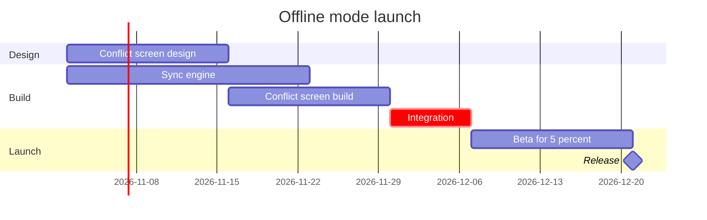

# Example - Gantt - Loomlist Offline Mode

Loomlist is a fictional workspace app used across the Product Owner fixtures. Every date and task here is invented for the example.

---

## 1. REQUEST

```text
put the offline mode launch plan on a FigJam gantt chart, from the planning doc
```

| Doc line | Says | Class |
|---|---|---|
| 1 | Design starts 2 November with two weeks of conflict-screen design | approved direction |
| 2 | The sync engine takes three weeks from the same day | approved direction |
| 3 | The conflict screen build follows its design, two weeks | approved direction |
| 4 | Desktop and iOS integration starts when both builds are done, one week, and is the critical path | approved direction |
| 5 | A two-week beta for 5% of workspaces, then the release | approved direction |
| 6 | Android follows in the next quarter | proposal |

---

## 2. TYPE AND DIALS

- **Reader question:** which work runs when, and what holds the release? A gantt chart
- **Detail:** balanced. **Audience:** mixed

---

## 3. MODEL



### Provenance

| Task | Source | Source class |
|---|---|---|
| design | Doc line 1 | approved direction |
| engine | Doc line 2 | approved direction |
| screen | Doc line 3 | approved direction |
| integrate | Doc line 4 | approved direction |
| beta, Release | Doc line 5 | approved direction |

```text
Left out: Android next quarter, a proposal with no dates
```

### Check

```text
  diagram 1, gantt: ok, 6 tasks in 3 sections
PASSED 1 diagram(s) in model.md
```

---

## 4. GATE

```text
Plan: Loomlist Product. File: a new FigJam file, which this call creates.
Writes: one gantt chart, 3 sections, 6 tasks and 1 milestone, named "Offline mode launch".
Rollback: delete the new file.
Write it?
```

---

## 5. REPLY

```text
<board URL from generate_diagram>
Read-back: 3 of 3 sections, 6 of 6 tasks, 1 of 1 milestones
Left out: Android next quarter, a proposal with no dates
HVR self-scan: 0 hard blockers. Fixed: none. Kept with reason: none.
```
