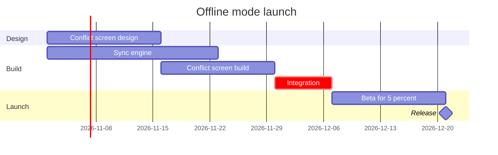

# Example - Gantt - Loomlist Offline Mode

Loomlist is a fictional workspace app used across the Product Owner fixtures. Every date and task here is invented for the example.

---

## 1. REQUEST

```text
put the offline mode launch plan on a FigJam gantt chart, from the planning doc
```

| Doc line | Says | Class |
|---|---|---|
| 1 | Design starts 2 November with two weeks of conflict-screen design | approved direction |
| 2 | The sync engine takes three weeks from the same day | approved direction |
| 3 | The conflict screen build follows its design, two weeks | approved direction |
| 4 | Desktop and iOS integration starts when both builds are done, one week, and is the critical path | approved direction |
| 5 | A two-week beta for 5% of workspaces, then the release | approved direction |
| 6 | Android follows in the next quarter | proposal |

---

## 2. TYPE AND DIALS

- **Reader question:** which work runs when, and what holds the release? A gantt chart
- **Detail:** balanced. **Audience:** mixed

---

## 3. PLAYBACK

The playback is its own reply, sent before the model. It waits for its own answer, and a yes to it moves the work on to the model and writes nothing.

```text
Before I draw anything, this is how I read the request.
Question: which work runs when, and what holds the release?
Outcome: a reader can see the order of the offline mode work, the critical path and where the release lands.
Settled by the sources: planning doc lines 1 to 5 give the tasks, their dates and durations, the dependencies and the critical path.
Left out: Android next quarter, a proposal with no dates.
Assumed: balanced detail and a mixed audience.
Still open: none.
Is this the right reading of the board?
```

---

## 4. MODEL



### Provenance

| Task | Source | Source class |
|---|---|---|
| design | Doc line 1 | approved direction |
| engine | Doc line 2 | approved direction |
| screen | Doc line 3 | approved direction |
| integrate | Doc line 4 | approved direction |
| beta, Release | Doc line 5 | approved direction |

```text
Left out: Android next quarter, a proposal with no dates
```

### Check

```text
  diagram 1, gantt: ok, 6 tasks in 3 sections
PASSED 1 diagram(s) in model.md
```

The check counts every task line, so its 6 is the 5 tasks and the Release milestone. The gate and the read-back count the milestone once, apart from the tasks.

---

## 5. GATE

The gate is its own reply, sent after the playback's answer. Its one question asks about the write alone.

```text
Question: which work runs when, and what holds the release?
Outcome: a reader can see the order of the offline mode work, the critical path and where the release lands.
First glance: Integration, the critical path task that holds the release.
Second glance: Sync engine and Conflict screen build, the two builds Integration waits for.
Last glance: Beta for 5 percent and the Release milestone at the end.
Plan: Loomlist Product. File: a new FigJam file named "Offline mode launch", created in that plan.
Writes: one composed board, 3 sections, 5 tasks and 1 milestone on one axis, with a title, a key and a source line, at the Laptop reading distance.
Left out: Android next quarter, a proposal with no dates
Extensions: none.
Calls: whoami, create_new_file, one use_figma and one get_figjam read-back.
Rollback: delete the new file.
Write it?
```

---

## 6. REPLY

```text
<board URL>
Read-back: 3 of 3 sections, 5 of 5 tasks, 1 of 1 milestone, first glance: Integration, the critical path
Left out: Android next quarter, a proposal with no dates
HVR self-scan: 0 hard blockers. Fixed: none. Kept with reason: none.
```
