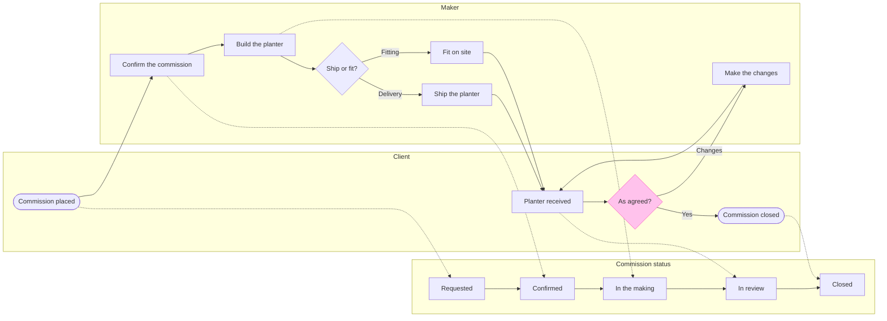

# Example - Process - Fernhouse Commission

Fernhouse is a fictional store used across the Product Owner fixtures. Every name, step and rule here is invented for the example.

---

## 1. REQUEST

```text
make a FigJam board of how a made-to-order planter moves between the client and the maker, with the status the commission is in at each step, from the commission spec, and keep the spec's detail on the steps
```

| Spec line | Says | Class |
|---|---|---|
| 2.1 | The client places a commission through the order form. Its status is Requested | current behavior |
| 2.2 | The maker confirms the commission within two working days: size, wood, finish and delivery or fitting. Its status moves to Confirmed | current behavior |
| 2.3 | The maker builds the planter. Its status moves to In the making | current behavior |
| 2.4 | A delivered planter ships in a wooden crate with a tracking link. A fitted planter is placed on site on an agreed date | current behavior |
| 2.5 | Once the client has the planter, its status moves to In review. The client approves it or names the changes | current behavior |
| 2.6 | The maker makes the changes and returns the planter, as often as the client asks | current behavior |
| 2.7 | An approved planter closes the commission. Its status moves to Closed | current behavior |
| 2.8 | A deposit is taken at confirmation. Planned, not yet live | proposal |

---

## 2. TYPE AND DIALS

- **Reader question:** who does what, and which status is the commission in at each step? A process with a status lane and two actor lanes
- **Detail:** faithful, because the request asks to keep the spec's detail on the steps. **Audience:** mixed. **Distance:** laptop
- **Focus:** As agreed?, the decision every change loop returns to

---

## 3. MODEL



### Provenance

| Node | Source | Source class |
|---|---|---|
| order, requested | Spec 2.1 | current behavior |
| confirm, confirmed | Spec 2.2 | current behavior |
| build, making | Spec 2.3 | current behavior |
| route, ship, fit | Spec 2.4 | current behavior |
| receive, check, review | Spec 2.5 | current behavior |
| change | Spec 2.6 | current behavior |
| done, closed | Spec 2.7 | current behavior |

```text
Left out: the deposit, not yet live
```

### Check

```text
  diagram 1, process: ok, 15 nodes and 20 connectors, widest rank 2 steps, longest path 8 steps, 1.1 connectors per step, labels average 15 characters, 0 crossing pairs
Glance: As agreed? (accent) > Commission placed > Requested > Confirm the commission > Confirmed > Build the planter > In the making > Ship or fit? > Ship the planter > Fit on site > Planter received > In review > Commission closed (goal) > Make the changes > Closed
PASSED 1 diagram(s) in model.md
```

---

## 4. HOW THE BOARD READS

- **Status lane.** `%% status: status` names the lane that holds the commission's statuses. It is declared first, so the board draws it on top, and its states are joined in order by `-->`. Each step that moves the status draws a dotted gray `-.->` into the new status, which the key names `Moves the status`. A status is drawn as a chevron, so it never reads as a step
- **Detail cards.** `%% level: faithful` lets a step carry a body. Each `%% detail:` line gives one step its body lines, set under the one-line label after a small spacer, in the `body` type size. The label stays the step's name, and the body holds what the spec says about it
- **Subtitle.** The subtitle names where the flow starts, the client's order, and where it ends, the approved planter

---

## 5. REPLY

```text
<board URL>
Read-back: 15 of 15 nodes, 20 of 20 connectors, 4 of 4 decision exits labelled, 3 of 3 lanes, first glance: As agreed?
Left out: the deposit, not yet live
HVR self-scan: 0 hard blockers. Fixed: none. Kept with reason: none.
```
