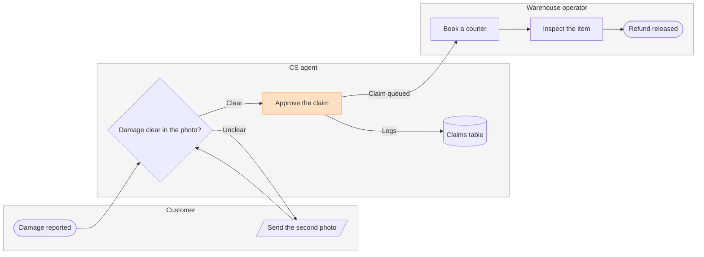

# Example - Process - Fernhouse Refund

Fernhouse is a fictional store used across the Product Owner fixtures. Every name, step and rule here is invented for the example.

---

## 1. REQUEST

```text
make a FigJam process of how a damaged-item refund moves between the customer, CS and the warehouse, from the support runbook
```

| Runbook line | Says | Class |
|---|---|---|
| 3.1 | The customer reports damage with a photo through the help form | current behavior |
| 3.2 | A CS agent checks the photo. Clear damage is approved on the spot, unclear damage asks the customer for a second photo | current behavior |
| 3.3 | An approved claim goes to the warehouse queue, where an operator books a courier pickup | current behavior |
| 3.4 | The operator inspects the item on arrival and releases the refund | current behavior |
| 3.5 | Every decision is logged in the claims table | current behavior |
| 3.6 | Refunds under €20 skip the pickup. Pilot, not yet live | proposal |

---

## 2. TYPE AND DIALS

- **Reader question:** who does what, and where does the claim change hands? A process with three lanes
- **Detail:** balanced. **Audience:** mixed
- **Focus:** Approve the claim, the step that hands the claim from CS to the warehouse, which the runbook names as the slowest handoff

---

## 3. PLAYBACK

The playback is its own reply, sent before the model. It waits for its own answer, and a yes to it moves the work on to the model and writes nothing.

```text
Before I draw anything, this is how I read the request.
Question: who does what, and where does the claim change hands?
Outcome: a reader can see which team owns each step of a damaged-item refund and where the claim moves from CS to the warehouse.
Settled by the sources: runbook lines 3.1 to 3.5 give the steps, the three lanes and the one decision, and the runbook names the handoff from CS to the warehouse as the slowest.
Left out: the pickup skipped under €20 in line 3.6, a pilot that is not live.
Assumed: balanced detail and a mixed audience.
Still open: none.
Is this the right reading of the board?
```

---

## 4. MODEL



### Provenance

| Node | Source | Source class |
|---|---|---|
| report | Runbook 3.1 | current behavior |
| check, photo, approve | Runbook 3.2 | current behavior |
| pickup | Runbook 3.3 | current behavior |
| inspect, refund | Runbook 3.4 | current behavior |
| log | Runbook 3.5 | current behavior |

```text
Left out: pickup skipped under €20, a pilot that is not live
```

### Check

```text
  diagram 1, process: ok, 8 nodes and 8 connectors, widest rank 2 steps, longest path 6 steps, 1.0 connectors per step, labels average 17 characters, 0 crossing pairs
Glance: Approve the claim (accent) > Damage clear in the photo? > Damage reported > Send the second photo > Claims table > Book a courier > Inspect the item > Refund released (goal)
PASSED 1 diagram(s) in model.md
```

---

## 5. GATE

The gate is its own reply, sent after the playback's answer. Its one question asks about the write alone.

```text
Question: who does what, and where does the claim change hands?
Outcome: a reader can see which team owns each step of a damaged-item refund and where the claim moves from CS to the warehouse.
First glance: Approve the claim, the handoff from CS to the warehouse that the runbook names as the slowest.
Second glance: Damage clear in the photo?, the decision beside the handoff on its row, then Damage reported, the light blue entry where the claim starts, then Send the second photo, the loop back to the customer, the claims table, where every decision is logged, then Book a courier, Inspect the item and Refund released, the goal, in the order the check's Glance line prints.
Last glance: the key and the source line, since the goal comes last.
Sketch: the Section 4 model above in full, every `%%` and `style` line included, with the check's PASSED line as it printed.
Eye first: Approve the claim, the handoff the runbook names as the slowest, and it is the node the board most needs read.
Reads second: Damage clear in the photo? beside it, then the claim from Damage reported to Refund released, column by column across the lanes, which shows who holds the claim at each step.
Could miss: Send the second photo, the loop back to the customer, which would hide why some claims stall.
Remove next: the claims table, kept because every decision on the claim is logged there.
Plan: Fernhouse Product. File: a new FigJam file named "Damaged-item refund", created in that plan.
Writes: one composed board, 3 lanes, 8 nodes and 8 connectors, with a title, a key and a source line, at the Laptop reading distance.
Left out: pickup skipped under €20, a pilot that is not live
Extensions: none.
Calls: whoami, create_new_file, one use_figma and one get_figjam read-back.
Rollback: delete the new file.
Write it?
```

---

## 6. REPLY

```text
<board URL>
Read-back: 8 of 8 nodes, 8 of 8 connectors, 2 of 2 decision exits labelled, 3 of 3 lanes, first glance: Approve the claim
Left out: pickup skipped under €20, a pilot that is not live
HVR self-scan: 0 hard blockers. Fixed: none. Kept with reason: none.
```
