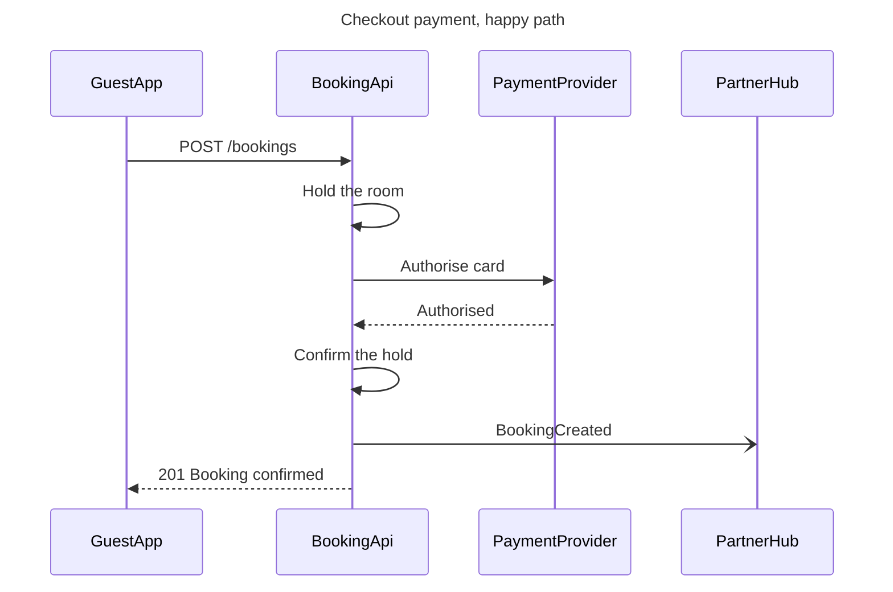

# Example - Sequence - Roamstay Checkout

Roamstay is a fictional booking marketplace used across the Product Owner fixtures. Every service, path and status here is invented for the example.

---

## 1. REQUEST

```text
draw the checkout payment as a sequence diagram in FigJam, from the payments API brief
```

The brief lists the calls in order: the guest app posts the booking, the booking API holds the room, asks the payment provider to authorise the card, confirms the hold and tells the partner's hub, then answers the app. A declined card releases the hold and returns 402.

---

## 2. TYPE AND DIALS

- **Reader question:** in what order do the app, the booking API, the payment provider and the hub exchange messages? A sequence
- **Detail:** balanced. The decline is a second path, and `alt` renders flat, so it becomes its own diagram if asked for
- **Audience:** engineer, so paths and status codes stay in the labels

---

## 3. PLAYBACK

The playback is its own reply, sent before the model. It waits for its own answer, and a yes to it moves the work on to the model and writes nothing.

```text
Before I draw anything, this is how I read the request.
Question: in what order do the app, the booking API, the payment provider and the hub exchange messages?
Outcome: the payments team can read the checkout calls in order, with their paths and status codes, for a card that is authorised.
Settled by the sources: the payments API brief gives the calls in order, for the authorised card and for the declined card.
Left out: the declined-card path, kept for a second diagram if you want one.
Assumed: balanced detail and an engineer audience, so paths and status codes stay in the labels.
Still open: none.
Is this the right reading of the board?
```

---

## 4. MODEL



### Provenance

| Message | Source | Source class |
|---|---|---|
| Every message | Payments API brief, Section 2 | current behavior |

```text
Left out: the declined-card path, 402 and the released hold, kept for a second diagram
```

### Check

```text
  diagram 1, sequence: ok, 4 participants and 7 messages
PASSED 1 diagram(s) in model.md
```

---

## 5. GATE

The gate is its own reply, sent after the playback's answer. Its one question asks about the write alone.

```text
Question: in what order do the app, the booking API, the payment provider and the hub exchange messages?
Outcome: the payments team can read the checkout calls in order, with their paths and status codes, for a card that is authorised.
First glance: Authorise card, the call to the payment provider that decides the checkout.
Second glance: Authorised, the answer that lets the booking API confirm the hold and answer the app.
Last glance: BookingCreated, the message to the partner hub that does not hold up the answer.
Plan: Roamstay Product. File: a new FigJam file named "Checkout payment, happy path", created in that plan.
Writes: one composed board, 4 participants and 7 numbered messages, with a title, a key and a source line, at the Laptop reading distance.
Extensions: none.
Calls: whoami, create_new_file, one use_figma and one get_figjam read-back.
Rollback: delete the new file.
Write it?
```

---

## 6. REPLY

```text
<board URL>
Read-back: 4 of 4 participants, 7 of 7 messages, first glance: Authorise card
Left out: the declined-card path, 402 and the released hold, kept for a second diagram
HVR self-scan: 0 hard blockers. Fixed: none. Kept with reason: none.
```
