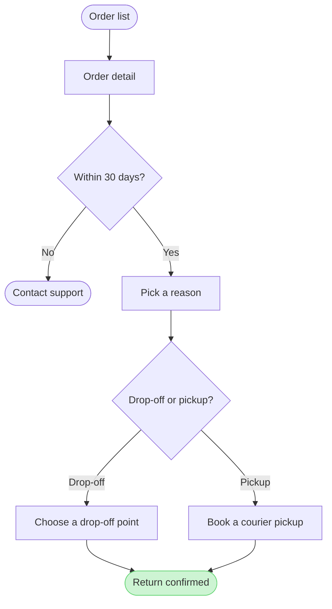

# Example - User Flow - Fernhouse Return

Fernhouse is a fictional store used across the Product Owner fixtures. Every name, screen and rule here is invented for the example.

---

## 1. REQUEST

```text
$flow how a customer starts a return in the app, from these screenshots and the returns doc
```

Sources: five app screenshots and a returns doc.

| Source | Says |
|---|---|
| `Orders - Tap_ Order row.png` | The order list, a row under the finger |
| `Order detail - Tap_ Start a return.png` | The order page with a Start a return button |
| `Return reason - Select_ Reason.png` | A list of reasons |
| `Return method - Select_ Drop-off or pickup.png` | Two choices: a drop-off point or a courier pickup |
| `Return confirmed.png` | A confirmation with a QR code |
| Returns doc, Section 2 | Returns are open for 30 days after delivery. After that the app shows Contact support. Current behavior |
| Returns doc, Section 4 | A free pickup for orders over €100. Proposal, under review |

---

## 2. TYPE AND DIALS

- **Reader question:** which screens does a customer pass through to start a return, and where do they choose? A user flow
- **Detail:** balanced. **Audience:** mixed, so the labels use the app's own words

---

## 3. MODEL

The first draft, kept as text because it fails the check:

```text
flowchart TD
    orders([Order list]) --> detail[Order detail]
    detail --> window{Within 30 days?}
    window -->|No| support([Contact support])
    window -->|Yes| reason[Pick a reason]
    reason --> method{Drop-off or pickup?}
    method -->|Drop-off| dropoff[Choose a drop-off point]
    method -->|Pickup| pickup[Book a courier pickup]
    dropoff --> merge((.))
    pickup --> merge
    merge --> confirmed([Return confirmed])
    style confirmed fill:#CDF4D3,stroke:#66D575
```

That is ten nodes, one over the budget:

```text
  diagram 1, user flow: 10 nodes, at most 9: split the flow
```

The merge dot goes: both methods lead straight to the confirmation, which says the same thing with one node less. The model that goes forward:



### Provenance

| Node | Source | Source class |
|---|---|---|
| orders | `Orders - Tap_ Order row.png` | current behavior |
| detail | `Order detail - Tap_ Start a return.png` | current behavior |
| window | Returns doc, Section 2 | current behavior |
| support | Returns doc, Section 2 | current behavior |
| reason | `Return reason - Select_ Reason.png` | current behavior |
| method, dropoff, pickup | `Return method - Select_ Drop-off or pickup.png` | current behavior |
| confirmed | `Return confirmed.png` | current behavior |

```text
Left out: free pickup over €100, a proposal under review
```

### Check

```text
  diagram 1, user flow: ok, 9 nodes and 9 connectors, widest rank 2 steps, longest path 7 steps, 1.0 connectors per step, labels average 16 characters, 0 crossing pairs
PASSED 1 diagram(s) in model.md
```

---

## 4. GATE

```text
Plan: Fernhouse Product. File: a new FigJam file, which this call creates.
Writes: one user flow, 9 nodes and 9 connectors, named "Start a return".
Rollback: delete the new file.
Write it?
```

---

## 5. REPLY

```text
<board URL from generate_diagram>
Read-back: 9 of 9 nodes, 9 of 9 connectors, 4 of 4 decision exits labelled
Left out: free pickup over €100, a proposal under review
HVR self-scan: 0 hard blockers. Fixed: none. Kept with reason: none.
```
