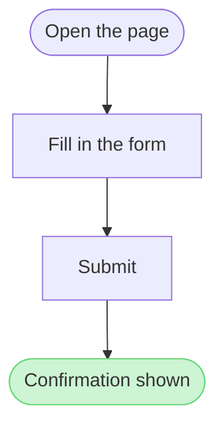
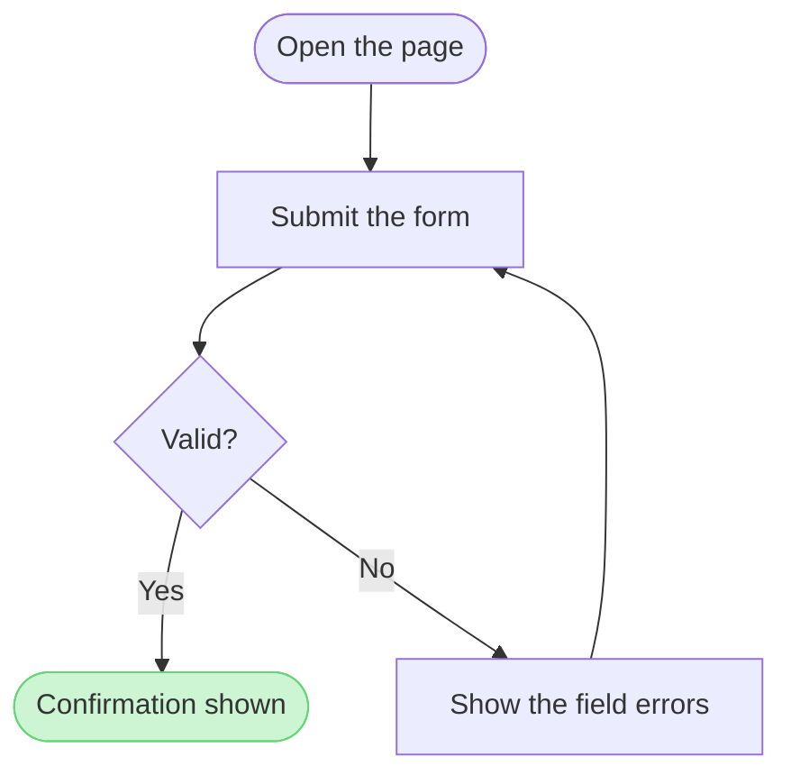
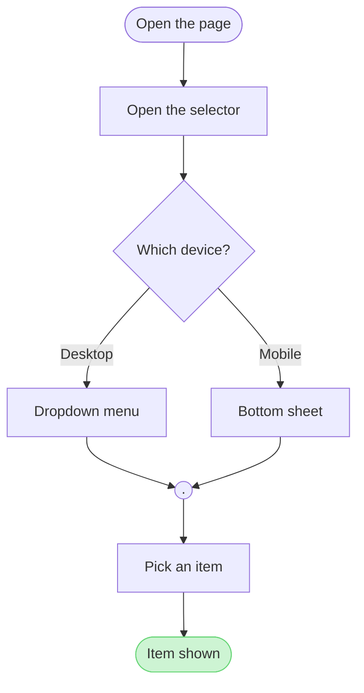
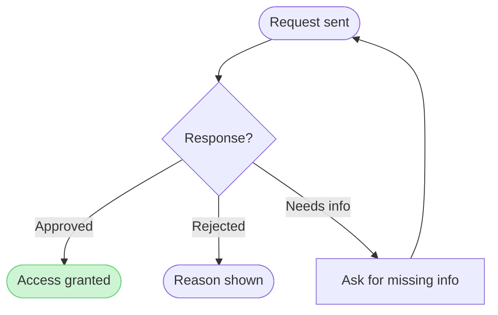
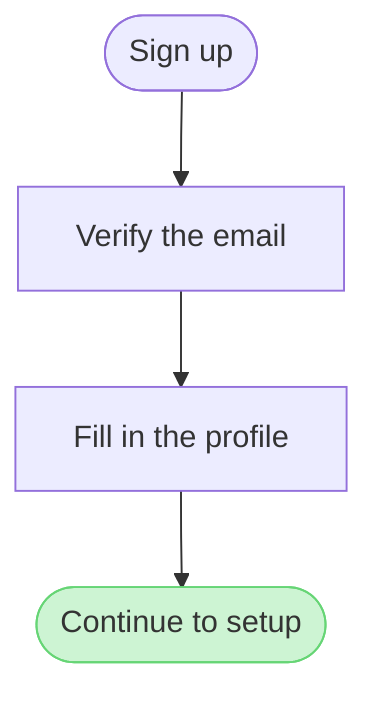
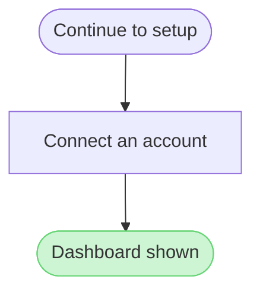

# Product Owner Flow Templates

Copy/apply patterns for Product Owner Flow Mode models.

**Loading Condition:** CONDITIONAL, with `references/flow-mode.md` whenever Flow intent is selected
**Purpose:** Provides the user-flow patterns, the provenance table every diagram type keeps and the reply shape every type delivers
**Scope:** Five user-flow patterns, the intake questions, the provenance table and the reply shape. The other types keep their patterns in `assets/templates/`
**Output Path:** None. The model is working data and the board is the deliverable

---

## 1. OVERVIEW

### Purpose

Every pattern below passes `scripts/flow_check.py` as a user flow, and `scripts/compose_board.py` composes it into a board. Start from the pattern closest to the flow, rename the nodes after the real screens and triggers, add the board lines below and run the check before the write gate. A process, an architecture, a sequence, a state diagram, an ER diagram or a gantt chart starts from its own file in `assets/templates/`, and keeps the provenance table and the reply shape below.

### Usage

- Node ids are short, stable and camelCase, because the provenance table names them, the composer names every layer after them and the generated fallback mis-routes an underscore
- A label names the screen or the action a person takes, in the words the product uses, in one to four words where those words allow
- A label with a parenthesis, a colon or a slash goes in double quotes, such as `pick["Pick a plan (monthly)"]`
- A decision label is a question, and each exit label is one of its answers
- Every connector is a solid arrow `-->`
- A user flow and a process each carry exactly one `style` line, which marks the first glance. A styled goal, failing end or decision keeps its kind and takes a pink outline, and a styled step is drawn light pink. `style done fill:#CDF4D3,stroke:#66D575` makes that end the goal and the light red pair makes an end a failure. Every pair comes from `references/style-guide.md`, and any other colour is refused or counts as a second accent
- Write `flowchart LR` unless the chain is short, because a board reads wider than it reads tall

### Board lines

The board's own text rides on `%%` comment lines, which the check ignores and the composer reads. Each one is optional, and the generated fallback strips them all:

```text
%% title: Start a return
%% subtitle: How a customer starts a return in the app, from the order list to a confirmed return
%% source: Sources: five app screenshots and the returns doc. Left out: free pickup over 100 euros, a proposal.
%% zone: Find the order: orders, detail
%% zone: Request the return: window, reason, method
```

- `%% title:` names the board. With none, the composer takes a Mermaid frontmatter title, a sequence or gantt `title` line, then `Diagram <n>`
- `%% subtitle:` is one sentence under the title on who reads the board and why
- `%% source:` is the line under the key naming the sources and what was left out
- `%% zone: <label>: <id>, <id>` groups nodes in a tinted section. A user flow or a process without lanes reads its zones in flow order, and once a flow has zones every node sits in exactly one. An ER diagram draws each zone around its entities. Lanes and composite states are zones already, so a laned process, an architecture or a state diagram takes no zone line

---

## 2. PATTERNS

### Linear flow



### One decision



### Platform split with a merge dot



### Three outcomes



### A flow split across two diagrams

Divide the ordered source list into groups of at most 9 nodes before the first Mermaid block, each group ending on a hand-off node that names it, so the split is read off the sources rather than a model that already overran. A flow over 9 nodes ends the first diagram on a named hand-off and starts the second diagram from the same name. Both diagrams go into the same file as two boards, read left to right: the second write passes the `fileKey` the first one used, and each board's `%% title:` carries its ordinal and its hand-off, such as `1. Sign up` and `2. Setup`. Every source step lands in one of the diagrams or is listed as left out under the provenance table. When the user asked in so many words for one board, cut the lowest-priority part instead, name it under `Left out:` and offer this split in the playback, as `references/flow-mode.md` Section 5 sets out.





---

## 3. PROVENANCE TABLE

One row per item, written in the intake before any Mermaid, beside the model and never on the board. An item is a node, a state, a participant, an entity, a task or an edge. An edge earns a row whenever it was inferred rather than read off a source, because a row kept only for an edge whose ends differ leaves an inferred connector unclassified.

| Item | Kind | Source | Source class | Confidence | Rung |
|---|---|---|---|---|---|
| start | node | `<screenshot file, Figma node or doc section>` | current behavior | high | stated |
| valid | node | `<source that states the check>` | current behavior | high | stated |
| start to valid | edge | `<neighbouring frames with no stated move>` | current behavior | medium | `<ladder step>` |

The source class is one of current behavior, approved direction, proposal, retired material and unknown. A row marked proposal or unknown carries its status into the node label, or the node is left out.

The confidence is `high`, `medium` or `low`. `high` is an item a source states, `medium` is an item one source implies and `low` is an item the ladder reached by joining two sources. Confidence is not the Brief's status, which says whether a row was captured, so the two sit on one item without repeating each other. The rung is the step of the inference ladder in `references/flow-mode.md` Section 4 that produced the row, and it reads `stated` when a source states the item outright.

A `medium` or `low` row carries its uncertainty in the node label or is left out, so the board never shows a confident shape over a thin source. A board has no marker to hide, so the label is where the uncertainty lives.

Where a frame name and the frame's visible heading differ, both are recorded in the row and the heading labels the node, because the heading is what the reader sees. The difference is a finding for the playback and is never resolved in the row.

Below the table, list every source item that is in no diagram, each with its reason. This is the fidelity ledger sk-design-diagram asks for, so a split or a cut at a lower detail level is named here too:

```text
Left out: <source item>, <reason, such as retired material, a split that ends before it or a cut at the simplified detail level>
```

---

## 4. REPLY SHAPE

```text
<board URL>
Read-back: <counts the type's reference names, each as n of n>
Extensions: <n> of <n> pins, <n> of <n> legend stickies, <n> overlaps
Left out: <source item>, <reason>
Finding: <a read-back finding, a write warning, an open item or a question>
HVR self-scan: <n> hard blockers. Fixed: <terms>. Kept with reason: <terms>.
```

The `Read-back:` counts follow the type: nodes, connectors and labelled decision exits for a user flow, lanes as well for a process, participants and messages for a sequence, states and transitions for a state diagram, entities, relationships and attributes for an ER diagram, and sections, tasks and milestones for a gantt chart. The `Extensions:` line appears only when the write added any, and the `Left out:` line only when the provenance table lists items left out, so the user sees what the board does not hold. When only a screenshot could be read, the read-back line ends with `, read visually`, because a picture cannot prove which nodes a connector joins. When a board was written and the connector has no read tool, the line is `Read-back: not possible, the connector has no read tool`, and the board is never called done.

These lines are the whole reply, and the self-scan is always the last. Each finding, warning, open item or question is one `Finding:` line, and nothing follows the self-scan. The playback of the settled rows runs before the model and the gate, as `references/flow-mode.md` Section 8 sets out, and it never becomes a line here.

---

## 5. INTAKE QUESTIONS

The type table in `references/flow-mode.md` Section 3 reads as questions. Ask them as an interview before the model is written, in three rounds that depend on each other, because an answer in one round settles what the next round may ask.

| Round | Asks | Settles |
|---|---|---|
| One | The reader, the question and the outcome | Who the board is for, what it must answer and what the reader decides next |
| Two | Entry, exit and actors | Where the flow starts, where it ends and who takes each step |
| Three | Decisions, states, sources and class | Where the flow branches, which states exist, which source states each fact and what class that source holds |

When two types fit, or a type the user names does not fit what the brief describes, the type question is asked alone in the first reply, before round one, as `references/flow-mode.md` Section 3 sets out.

### Every question carries a reading and a recommendation

A user who does not know an answer should still be able to accept one, so every question is put in this shape:

```text
Reading: <what the sources already show for this question>
Question: <the one thing still open>
Recommended: <the answer the AI would take>
Why: <the one line of reason>
```

- One to three questions per round and no later round while an earlier one is open
- Never a question a supplied source already answers, because that answer is stated as the reading instead
- A round closes when each of its questions is answered, accepted or corrected

### A vague answer is asked again

An answer that names nothing is asked once more with one probe from this set, and never with the same wording twice:

- A concrete scenario, such as one example walked from the first click to the end
- An edge case, such as two of these arriving at once
- A contradiction, such as one source stating this and another stating the opposite
- A term, such as what one word means in this product
- A scale, such as how many of these exist on a busy day
- A failure mode, such as what the reader sees when one step fails
- A boundary, such as where this flow stops and another one begins

### An unanswered question is never a dead end

When the user skips a question or says they do not know, the AI takes the recommended answer. That fact is marked assumed in the Brief and named in the playback before the gate, so the user corrects it before anything is written. A recommendation the user accepts without supplying a source stays assumed, with what would settle it, and the playback names it. A row the user corrects is recorded as `corrected` and counts as settled. No later round asks it again.
