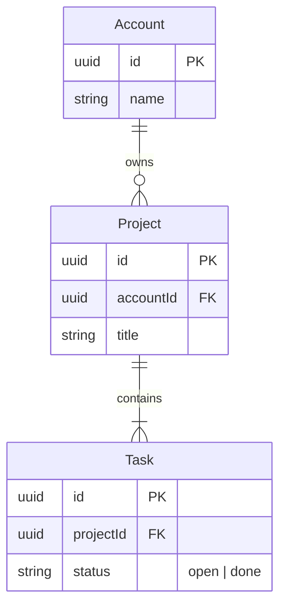
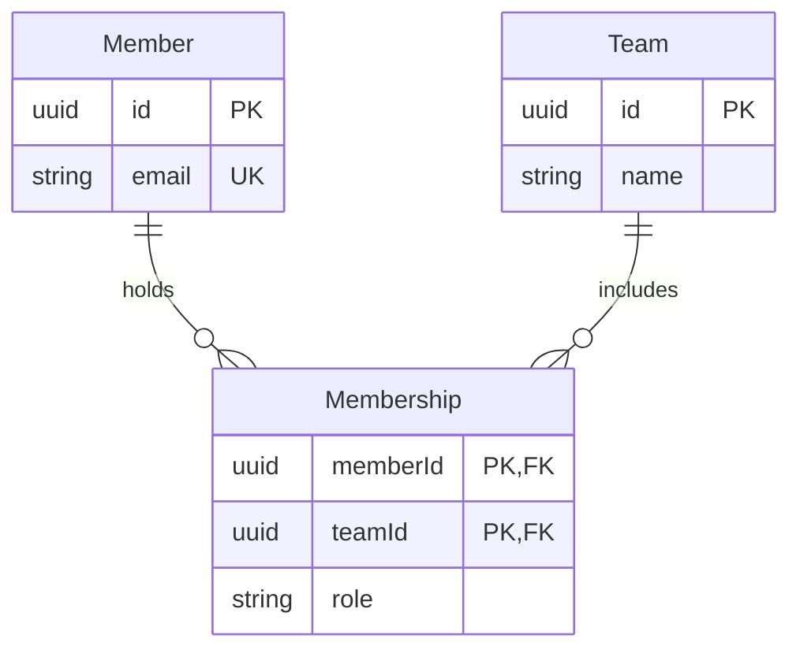
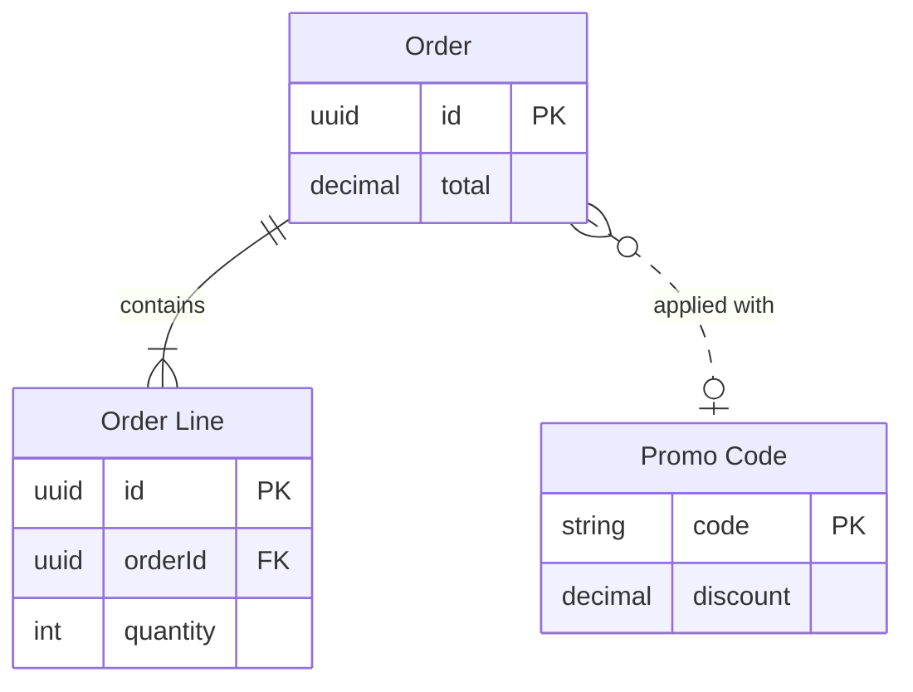

# FigJam ER Templates

Copy/apply patterns for an ER model. Each pattern passes `scripts/flow_check.py`, and `references/types/er.md` holds the rules.

**Loading Condition:** CONDITIONAL, with `references/types/er.md`
**Purpose:** Starting points for an ER diagram
**Scope:** Three patterns. The provenance table and the reply shape are in `assets/flow-templates.md`

---

## 1. USAGE

- Get the relationships and their cardinality right first, then add the 5 to 10 columns a reader needs
- Mark every `PK` and `FK`
- An alias goes on the entity block only, and relationships use the plain id

---

## 2. PATTERNS

### One-to-many core

### Many-to-many through a junction

### Aliased entity and a loose link

