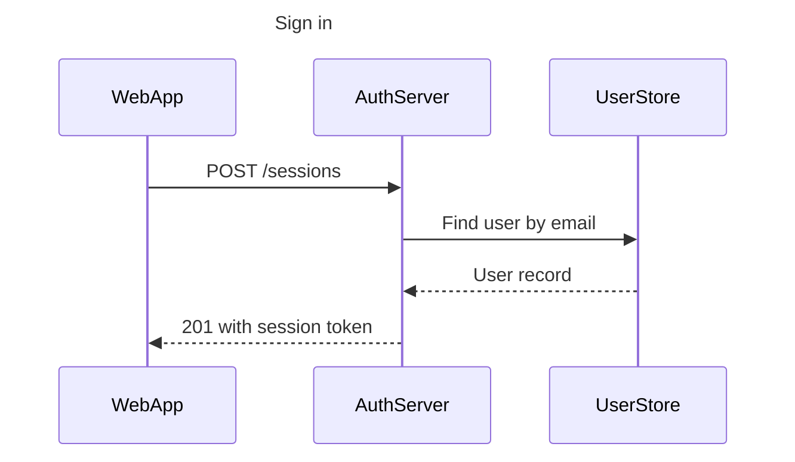
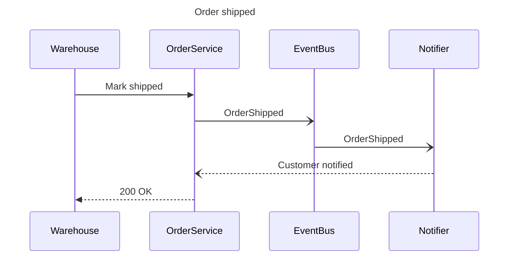

# FigJam Sequence Templates

Copy/apply patterns for a sequence model. Each pattern passes `scripts/flow_check.py`, and `references/types/sequence.md` holds the subset the board draws.

**Loading Condition:** CONDITIONAL, with `references/types/sequence.md`
**Purpose:** Starting points for a sequence
**Scope:** Two patterns. The provenance table and the reply shape are in `assets/flow-templates.md`

---

## 1. USAGE

- The participant id is what the board shows, so write `AuthServer`, never `a` with an alias
- Declare every participant in the order the board should show them
- `->>` for a request and `-->>` for its return. `-)` and `--)` only when the message really is fire-and-forget, such as telling another system an event happened, which the caller does not wait on
- A failure path is a second diagram, because `alt` renders flat

---

## 2. PATTERNS

### Request and response chain

### Event handoff

