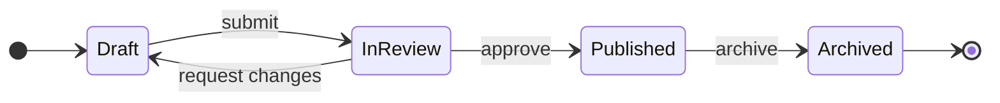
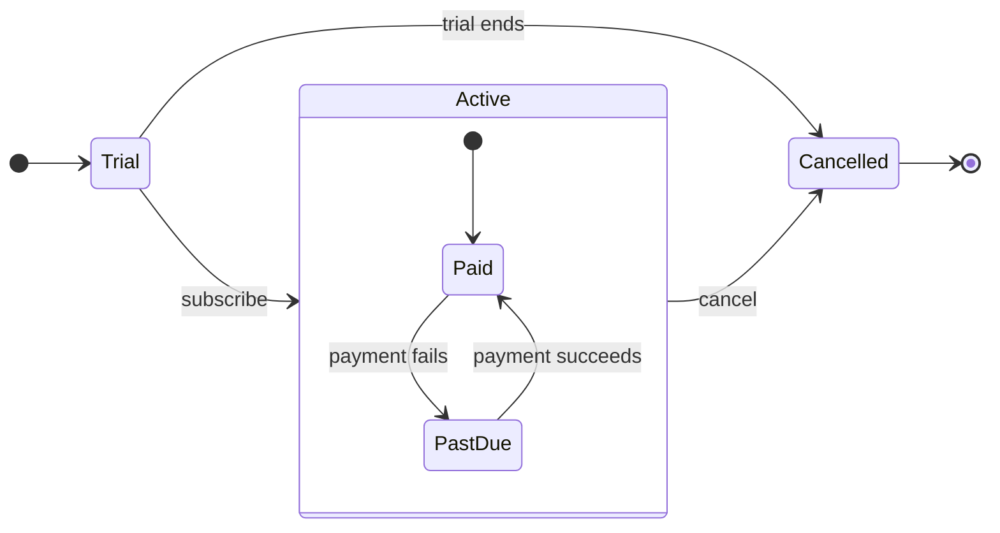
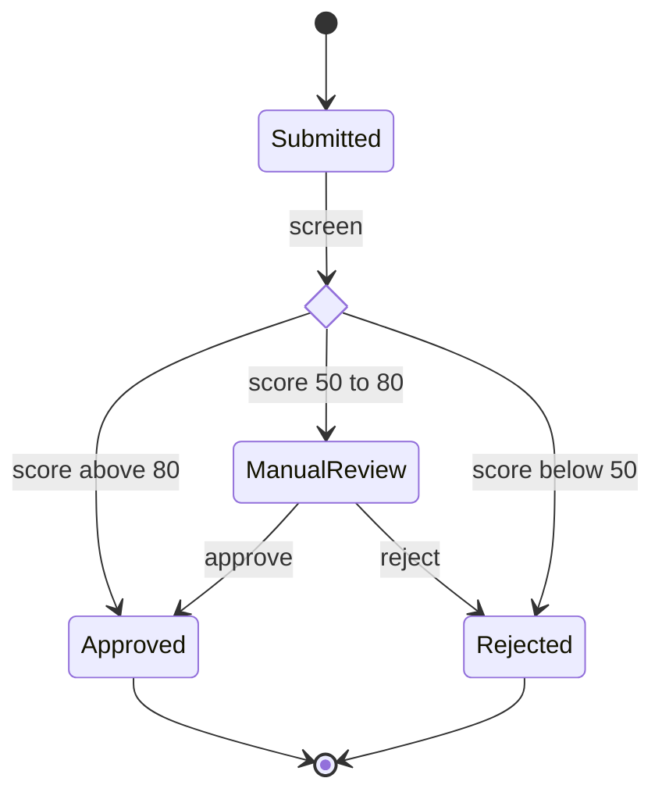

# FigJam State Templates

Copy/apply patterns for a state model. Each pattern passes `scripts/flow_check.py`, and `references/types/state.md` holds the rules.

**Loading Condition:** CONDITIONAL, with `references/types/state.md`
**Purpose:** Starting points for a state diagram
**Scope:** Three patterns. The provenance table and the reply shape are in `assets/flow-templates.md`

---

## 1. USAGE

- States are nouns or adjectives and labels are the events that move between them
- A long state name goes in a description, `Pending: Waiting for payment`, so the id stays one word
- No note and no style line, which would grow phantom states on the board

---

## 2. PATTERNS

### Lifecycle

### Composite with its own entry

### Guarded choice

